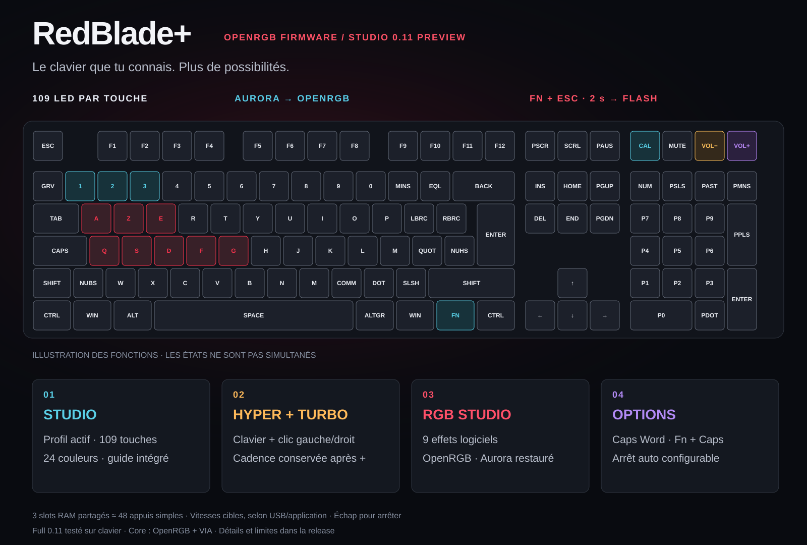

# RedBlade+ · OpenRGB Firmware

[English](README.md) · **Français**

<p align="center"></p>

<p align="center">
  <a href="https://github.com/Gaerisson/redblade-aurora-openrgb/releases/latest"></a>
  <a href="https://github.com/Gaerisson/redblade-aurora-openrgb/actions/workflows/test.yml"></a>
  <a href="LICENSE"></a>
</p>

Contrôle OpenRGB touche par touche, raccourcis Fn et fonctions de jeu pour le **Designed by GG Red Blade Full Size ISO**.

[Télécharger](https://github.com/Gaerisson/redblade-aurora-openrgb/releases/latest) · [Raccourcis](docs/SHORTCUTS.fr.md) · [Installation](docs/INSTALL.fr.md) · [Performances](docs/PERFORMANCE.md) · [Changelog](CHANGELOG.md)



## Studio 0.11.1 — aperçu Color Lab

Cliquez sur la carte des raccourcis pour un lecteur agrandi avec zoom à la molette et déplacement par glissement. **Intensité maximale** éclaircit les couleurs autonomes sélectionnées en conservant leur teinte et les touches éteintes, avec annulation possible. Cette mise à jour logicielle conserve les deux firmwares en 0.11.0 ; aucun flash n’est nécessaire.

RedBlade+ Studio est une application Windows x64 portable qui modifie le profil actif Full. Color Lab sélectionne les 109 touches par clic, glissement, cadre ou groupe ; applique une couleur unie ou un dégradé linéaire ou radial ; et propose un historique borné. À la connexion, choisissez de conserver les modifications locales ou de charger le profil du clavier. Le format à quatre profils reste compatible ; Core ne possède pas l’API de configuration Full. Le français, l’anglais et les légendes AZERTY/QWERTY restent disponibles. Voir [Studio](app/README.md).

Neuf effets PC prennent en charge palettes, zones et superposition réactive via OpenRGB. Les frappes réactives sont filtrées sur le clavier Red Blade et conservées temporairement en mémoire, sans journal de codes de touches ou de frappes. Full 0.11 ajoute trois styles réactifs autonomes ; chaque nouvelle frappe relance l’unique onde. Les vérifications de compilation et l’acceptation physique sont consignées séparément dans l’[audit](docs/AUDIT.md) et les notes de version.

[Télécharger Studio 0.11.1 et les deux firmwares](https://github.com/Gaerisson/redblade-aurora-openrgb/releases/tag/v0.11.1). Full 0.11 a été programmé et identifié sur le clavier de préparation. Après récupération d’une réponse d’identité immédiate malformée, VIA, les macros et les quatre profils d’origine ont été restaurés et relus intégralement. Le propriétaire a confirmé la saisie, le pavé, l’onde et sa couleur sauvegardées, ainsi que la frappe réactive logicielle. La correction de reconnexion en lecture seule est couverte par des tests ; aucun second flash physique n’a été effectué. Consultez le rapport de validation de la release. La persistance après coupure USB et la latence physique ne sont pas mesurées. Sauvegardez VIA et vos réglages avant tout flash.

Full 0.10 ajoute Caps Word (Fn + Verr. Maj, AZERTY/QWERTY) et un délai de sécurité pour les fonctions automatiques, tous deux désactivés par défaut. Studio utilise WebView2 Runtime sous Windows et suspend Aurora pendant ses effets logiciels avant de le rétablir.

Studio peut rechercher et télécharger automatiquement les mises à jour GitHub officielles, puis redémarrer après 30 secondes d’inactivité en l’absence de modifications non enregistrées et d’opération active. L’installation du firmware reste guidée et exige Fn + Échap physiquement ; aucun flash ne démarre au lancement.


*Interface réelle Color Lab, capturée en aperçu avec accès matériel désactivé.*

## Deux éditions

| Édition | Pour qui | Firmware |
| --- | --- | --- |
| **OpenRGB Core** | OpenRGB/Aurora par touche + VIA, sans fonctions de jeu, Recorder, effets locaux ou indicateurs ajoutés | `redblade-fs-openrgb-core.bin` |
| **RedBlade+ Full** | Toutes les fonctions présentées ci-dessous | `redblade-fs-aurora-via.bin` |

Chaque édition a son manifeste et un paquet de sources complet distinct. Core s’éteint après 5 s sans RGB et conserve Fn + Échap maintenu 2 s pour flasher. [Choisir/changer d’édition](docs/EDITIONS.md).

## Les fonctions

| Fonction | Utilisation |
| --- | --- |
| Intégration OpenRGB native | 109 LED indépendantes par VialRGB ; Aurora passe par le SDK OpenRGB |
| Bloc Fn multimédia | Calculatrice → Recorder avec rythme conservé, Muet → lecture/pause, Volume −/+ → piste précédente/suivante ; Maj ajoute d’autres commandes |
| Verrouillage Windows | Fn + une touche Windows ; les deux logos Windows deviennent rouges et le voyant Windows en haut à droite s’allume |
| Turbo au choix | Fn + T, puis une touche ; cadence réglable de 5 à 250/s avec Fn + −/+ du pavé ; préréglages E/F/Espace conservés |
| Turbo souris | Fn + T, puis Volume −/+ : clic gauche/droit, voyants ambre/violet, cadence partagée |
| Blanc réactif | Sans flux RGB : les frappes et lettres rejouées laissent une traînée rouge sur fond blanc |
| Couleurs de Fn | Respiration Recorder ; bleu au repos, cyan Fn enfoncée, rouge Turbo, vert maintien, violet jeu |
| Maintien pour avancer | Fn + Z en AZERTY / Fn + W en QWERTY ; LED verte |
| Arrêt immédiat | Échap arrête les fonctions automatiques ; Fn + Échap déverrouille aussi Windows |
| Profils lumineux locaux | Aurora/OpenRGB, blanc, rouge et éteint ; luminosité applicable aussi aux couleurs du PC |
| Secours dynamique | Sans flux RGB : Verr. Maj/Num verts, défilement ambre, pavé blanc si actif / blanc très faible sinon |
| Trois enregistrements temporaires | Fn + Calculatrice, puis Fn + 1/2/3 enregistre ; Fn + slot lit une fois ; Maj lance une boucle ; vitesse 0,5×–8× + Hyper |
| Éclairage de secours | Blanc optionnel après 5 secondes sans RGB, et secours pour les quatre touches multimédias |
| Vague rouge de démarrage | Animation courbe visible de 2 secondes et fondu vers les couleurs du PC |
| Préférences au choix | Fn + F9 enregistre l’éclairage ; commandes ordinaires et flux RGB restent en RAM |
| VIA | Remappage/macros et outil de mise à jour du calque Fn avec sauvegarde |

Les fonctions automatiques sont désactivées au départ et arrêtées à la suspension/déconnexion USB. Elles ne redémarrent pas seules. Elles agissent dans l’application active : le firmware ne reconnaît pas le jeu. Un Turbo peut fonctionner avec le maintien pour avancer ; un appui normal sur la touche concernée rend la main à ton doigt.

## Les raccourcis pour commencer

| Raccourci | Action |
| --- | --- |
| **Fn + Windows** | Activer/désactiver le mode jeu ; les deux logos deviennent rouges |
| **Fn + Calculatrice → Fn + 1** | Enregistrer le slot 1 ; Calculatrice à nouveau termine |
| **Fn + 1 / Maj + Fn + 1** | Lire le slot 1 une fois / en boucle |
| **Fn + −/+ du pavé** | Ajuster ; maintenir pour monter/descendre ; valeur conservée |
| **Fn + E** | Démarrer/arrêter le Turbo E |
| **Échap** | Arrêter Turbo et maintien pour avancer |
| **Fn + F1** | Rendre le contrôle lumineux à OpenRGB / Aurora |
| **Fn + F8** | Rétablir les réglages par défaut, arrêter les fonctions automatiques et déverrouiller Windows |

Le [guide complet des raccourcis](docs/SHORTCUTS.fr.md) explique les quatre touches, les cadences, les voyants, la sauvegarde et la récupération. À partir de la 0.6.0, **maintenir Fn + Échap pendant 2 secondes** ouvre le bootloader. Un appui court arrête les fonctions de jeu et déverrouille Windows. Les 0.4/0.5 utilisaient Fn + Maj + Échap.


[Schéma en grand](docs/assets/shortcuts.fr.svg) · [Version anglaise](docs/assets/shortcuts.png)

## Installation

| Matériel pris en charge | Valeur |
| --- | --- |
| Clavier | Red Blade **Full Size ISO**, avec pavé numérique — pas le Red Blade 75 |
| USB / contrôleur | `320F:5136` · Sonix SN32F248B |
| Éclairage | 109 LED, dont Calculatrice, Muet, Volume − et Volume + |

1. Télécharger le ZIP de la release et lire le [guide de sauvegarde/flash](docs/INSTALL.fr.md).
2. Sauvegarder VIA en privé, vérifier le bootloader et flasher le `.bin` avec SonixFlasherC.
3. Si l’ancien calque Fn de VIA a été conservé, utiliser [l’installateur Fn](docs/SHORTCUTS.md#upgrading-an-existing-via-layer) avec les clients RGB arrêtés.
4. Configurer OpenRGB/Aurora, puis choisir **Fn + F1** :

```powershell
pwsh -File tools/configure-windows.ps1 -Apply
pwsh -File tools/configure-aurora-mapping.ps1 -Apply
```

```text
Aurora / autre client SDK → OpenRGB → VialRGB → RedBlade+
```

OpenRGB fonctionne aussi sans Aurora. VIA et OpenRGB partagent l’interface Raw HID : fermer VIA pendant l’utilisation RGB. Le firmware fournit le sous-ensemble VialRGB nécessaire à OpenRGB, pas toute l’interface Vial.

## Performances et validation

- Polling USB demandé : **1 ms** ; anti-rebond eager d’origine, NKRO et horloge Sonix partagée conservés.
- Rendu par blocs de huit LED, intervalle minimal de 33 ms, indicateurs bornés et couleur Fn au repos/en activité. Turbo produit au plus une transition par passage, sans rattrapage en rafale ni attente active.
- Benchmark Windows et mesure USB en lecture seule inclus. [À lancer ce soir](docs/PERFORMANCE.md) ; les mesures du PC ne sont pas une mesure de latence physique des touches.

**La version 0.8.1 reste expérimentale.** Les fonctions de la série 0.8 ont été validées sur le clavier : blanc réactif, rejeu, Hyper conservé, Turbo clics et priorité Aurora. Sur 0.8.1, le voyant Windows, Fn seule éteinte, le maintien après relâchement de Fn, le fonctionnement RGB éteint, le déverrouillage, la saisie et Aurora sont confirmés. Core est compilée et testée sur PC, sans validation matérielle revendiquée. Voir [l’audit](docs/AUDIT.md), le [manifeste](dist/manifest.json) et les [tests](.github/workflows/test.yml).

Le RGB s’éteint lorsque l’USB est suspendu ou non configuré. Si le PC maintient réellement le bus USB actif après son arrêt, le firmware ne peut pas distinguer ce cas d’un logiciel RGB fermé ; cette limite est expliquée dans le [guide technique](docs/INSTALL.fr.md).

## Documentation

- [Installation complète](docs/INSTALL.fr.md) · [Référence anglaise](docs/INSTALL.md)
- [Tous les raccourcis](docs/SHORTCUTS.fr.md) · [Mesures de performances](docs/PERFORMANCE.md) · [Audit](docs/AUDIT.md)
- [Changelog en anglais](CHANGELOG.md) · [Contribuer](CONTRIBUTING.md) · [Logo et prompt](assets/LOGO.md)

Basé sur [SonixQMK épinglé](https://github.com/SonixQMK/qmk_firmware/tree/62973ee48a976c6f7cc6d4f7b198bd48a2fdfe60), avec [OpenRGB](https://github.com/CalcProgrammer1/OpenRGB) et [Aurora](https://github.com/Aurora-RGB/Aurora). Code ajouté sous GPL-2.0-or-later ; licences et sources amont conservées. [Licence](LICENSE).
