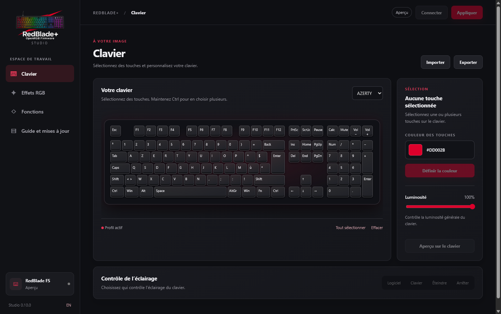
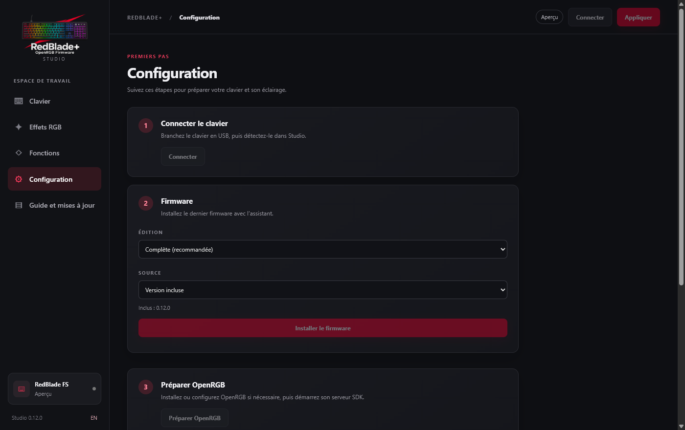
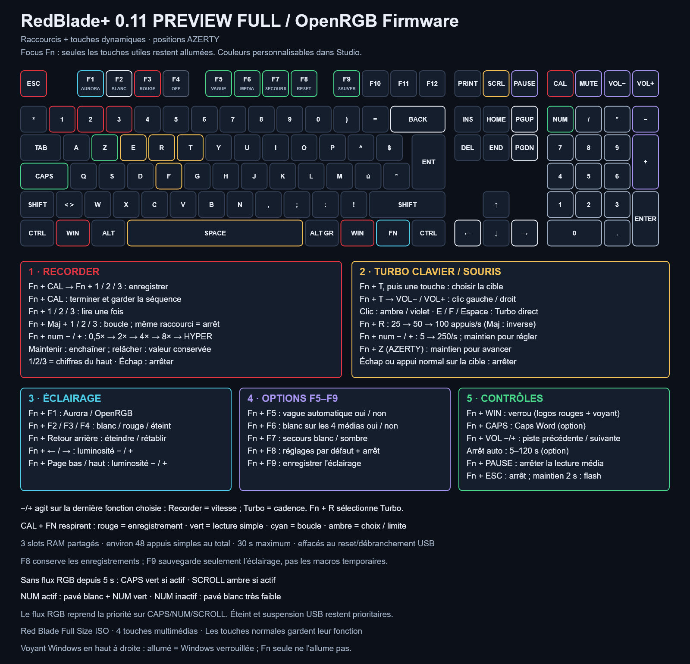

# RedBlade+ · Micrologiciel OpenRGB et Studio

[English](README.md) · **Français**

Éclairage touche par touche, profils intégrés et raccourcis pratiques pour le **Designed by GG Red Blade Full Size ISO**. RedBlade+ Studio réunit le clavier, l’éclairage et la configuration dans une application portable pour Windows x64.

[Télécharger Studio 0.14.0 pour Windows (EXE)](https://github.com/Gaerisson/redblade-aurora-openrgb/releases/tag/v0.14.0) · [Installation](docs/INSTALL.fr.md) · [Raccourcis](docs/SHORTCUTS.fr.md) · [Guide Studio](app/README.md) · [Historique des versions](CHANGELOG.md)

## Votre clavier, vos couleurs

- **Color Lab :** sélectionnez les touches par clic, glissement, cadre ou groupe de positions de jeu. Appliquez une couleur unie ou un dégradé linéaire ou radial, puis annulez ou rétablissez vos modifications. Modifiez le profil Full actif et enregistrez-le dans le clavier.
- **Éclairage sur le PC :** choisissez parmi 12 effets OpenRGB et des réactions à la frappe durant jusqu’à 8 secondes. Studio restaure vos applications RVB à l’arrêt de son effet.
- **Éclairage autonome :** Full 0.12 propose cinq styles de réaction durant jusqu’à environ 4 secondes, avec repères Ctrl, Maj et Alt facultatifs. Quatre profils intégrés conservent vos réglages sans effet actif sur le PC.
- **Raccourcis en un coup d’œil :** l’explorateur Fn présente un aperçu virtuel des combinaisons Fn et Maj ; il ne détecte pas l’appui physique sur Fn. Full inclut aussi le verrouillage Windows, Turbo, Recorder et les commandes multimédias.

Studio est disponible en français et en anglais, avec légendes AZERTY et QWERTY. L’aperçu virtuel et les effets logiciels sont distincts des réglages intégrés ; les nouvelles options autonomes nécessitent Full 0.12.

## Choisir son édition

| | OpenRGB Core | RedBlade+ Full |
| --- | --- | --- |
| Usage | OpenRGB/Aurora touche par touche et VIA | Fonctions Core, éclairage autonome et raccourcis |
| Éclairage sans logiciel | LED éteintes après cinq secondes sans flux RVB | Profils locaux, éclairage réactif et indicateurs |
| Fonctions de jeu et Recorder | Non inclus | Inclus |
| Fichier du micrologiciel | `redblade-fs-openrgb-core.bin` | `redblade-fs-aurora-via.bin` |

Les deux éditions prennent en charge les affectations et macros VIA ; **Fn + Échap maintenu deux secondes** ouvre le mode de programmation. Full permet de configurer les profils intégrés depuis Studio ; Core ne propose pas cette fonction. Voir les [détails des éditions](docs/EDITIONS.md).

## Configuration guidée

1. Utilisez un **Red Blade Full Size ISO** avec pavé numérique : USB `320F:5136`, Sonix SN32F248B et 109 LED. Le Red Blade 75 n’est pas pris en charge.
2. Téléchargez la version et lisez le [guide d’installation et de sauvegarde](docs/INSTALL.fr.md). Studio guide l’installation Full/Core, sauvegarde les données VIA en privé et demande le passage physique en mode de programmation. Lisez ses indications avant de continuer et conservez vos sauvegardes.
3. Dans Studio, téléchargez et vérifiez le paquet portable OpenRGB 1.1, démarrez son SDK et testez la détection du clavier à 109 LED. Un essai lumineux de six secondes vérifie le fonctionnement des effets. OpenRGB est téléchargé depuis sa source officielle et n’est pas inclus. Le démarrage Windows facultatif de Studio ne lance pas le RVB et ne demande pas d’élévation.
4. Pour Aurora, sélectionnez son fournisseur OpenRGB/RGB.NET et utilisez le port SDK indiqué par Studio. Si un serveur existant sur 6742 ne détecte pas le RedBlade, Studio peut utiliser 6743 en parallèle ; la configuration d’Aurora n’est pas modifiée automatiquement. OpenRGB fonctionne aussi sans Aurora.

Fermez VIA pendant l’utilisation des applications RVB : elles partagent l’interface Raw HID du clavier. RedBlade+ fournit le sous-ensemble VialRGB nécessaire à OpenRGB, sans l’ensemble de l’interface de configuration Vial. Le [guide d’installation](docs/INSTALL.fr.md) décrit aussi la programmation manuelle et la récupération.

## Raccourcis et éclairage

[Ouvrir le guide complet des raccourcis](docs/SHORTCUTS.fr.md) · [Carte en anglais](docs/assets/shortcuts.png)

**Fn + F1** rend le contrôle lumineux à OpenRGB/Aurora ; **Fn + F4** sélectionne l’extinction. Tant que Fn est maintenue, le guide des raccourcis reste visible dans ce mode. Ce comportement ne s’applique pas nécessairement à la suspension USB ni à une commande globale d’extinction VialRGB. **Échap** arrête les fonctions de jeu ; le [guide](docs/SHORTCUTS.fr.md) explique leur fonctionnement et leurs limites.

## Focus Ctrl / Maj / Alt

Dans **Studio > Fonctions > Repères Ctrl / Maj / Alt**, choisissez quand les repères s’appliquent, activez **Atténuer les autres touches**, réglez le pourcentage puis cliquez sur **Appliquer**. L’activation propose 70 % ; 0 % désactive l’atténuation et 100 % éteint le fond pendant le maintien du modificateur. Les touches utiles et les voyants importants restent visibles ; le fond retrouve sa luminosité au relâchement. Choisissez **Aussi sur le RGB logiciel** pour Aurora. Nécessite Full 0.14 ; les profils existants restent inchangés tant que l’option n’est pas modifiée.

## Mises à jour et validation

Studio peut rechercher les versions officielles GitHub et proposer une mise à jour logicielle vérifiée. Dans la fenêtre de démarrage, **Plus tard** reporte l’installation automatique au prochain lancement. Le micrologiciel n’est jamais programmé automatiquement : son installation reste guidée et exige le passage physique en mode de programmation.

Studio 0.14.0 inclut Full 0.14.0 et Core 0.12.1. Les deux surveillent le compteur de trames USB : après 250 ms sans progression, les 109 LED sont éteintes. Fermer Aurora seul conserve le profil autonome de Full. Les essais d’arrêt et de reprise sur le PC restent à faire ; si le contrôleur ou un concentrateur continue les trames USB après l’arrêt de Windows, le firmware ne peut pas le distinguer d’un PC actif. Full 0.13 ajoute les voyants Turbo synchronisés, le Turbo clic milieu (Fn + T puis Muet) et Anti-AFK facultatif (Fn + I). Après environ 30 secondes d’inactivité, Anti-AFK alterne un mouvement horizontal de souris de ±8 pixels et appuie brièvement sur W puis S ; une frappe, Échap, Fn + I, une remise à zéro, la suspension, le délai de sécurité ou une autre fonction l’arrête. Son activation est refusée si une touche ou un modificateur est maintenu. W correspond à la touche physique Z en AZERTY ; ces touches peuvent saisir du texte hors jeu car le focus n’est pas détecté. Il partage la case Auto-W. La cadence d’usine passe à 60/s ; les profils enregistrés conservent leur cadence. Dans Configuration, le démarrage avec Windows est facultatif pour l’utilisateur courant. La première opération matérielle peut demander une autorisation UAC, réutilisée pour la session Studio. La fenêtre native des prérequis vérifie WebView2, Visual C++ x64 et les ressources incluses ; leur première installation Microsoft nécessite Internet.

La notification de mise à jour apparaît lorsque Studio est visible et inactif, sans interrompre une saisie ou une opération matérielle. « Plus tard » reporte l’installation automatique au prochain lancement.

**État du firmware 0.12.0 :** Studio et Full/Core compilent et réussissent les tests sur PC, dont les vérifications dans WebView2. La programmation de Full 0.12, sa somme de contrôle, son identité et la restauration complète de VIA, des macros et des profils ont été vérifiées sur le clavier de préparation. Le propriétaire a confirmé la saisie, le pavé, le guide Fn après Fn+F4, l’extinction au relâchement et Aurora après Fn+F1. La détection SDK et l’essai lumineux de six secondes ont aussi réussi avec le serveur OpenRGB existant. La première installation OpenRGB gérée sur un PC vierge et la validation physique de Core restent à effectuer. La persistance après coupure, la charge prolongée et la latence physique n’ont pas été mesurées. La programmation de Full 0.13 et la restauration ont ensuite été vérifiées ; le propriétaire a confirmé le clic molette Turbo, les flashes Fn/cible à 5 clics/s, ainsi que le déplacement de souris renforcé, les courts mouvements avant/arrière Anti-AFK et leurs arrêts. Les notes de version 0.13 détaillent ces essais. Voir l’[audit](docs/AUDIT.md) et les résultats de validation 0.12.0 pour le détail.

L’[audit de luminosité](docs/RGB_BRIGHTNESS.md) n’a trouvé aucun gain logiciel caché : les canaux atteignent 255 et les multiplicateurs du pilote valent 1 par défaut. Les modifications électriques ou du multiplexage n’ont été ni mesurées ni mises en œuvre ; aucun gain supplémentaire n’est donc annoncé. Le projet conserve une interrogation USB demandée de 1 ms ; les [outils de performance](docs/PERFORMANCE.md) mesurent le côté PC, pas la latence physique des touches.

## Documentation et sources

[Installation](docs/INSTALL.fr.md) · [Raccourcis](docs/SHORTCUTS.fr.md) · [Éditions](docs/EDITIONS.md) · [Studio](app/README.md) · [Performances](docs/PERFORMANCE.md) · [Audit](docs/AUDIT.md) · [Contribuer](CONTRIBUTING.md)

La version comporte dix fichiers : EXE et ZIP Studio, deux BIN de firmware, deux manifestes, SHA256SUMS et trois archives de sources. Les mesures et images restent dans le dépôt et les archives de sources. Le projet utilise [SonixQMK épinglé](https://github.com/SonixQMK/qmk_firmware/tree/62973ee48a976c6f7cc6d4f7b198bd48a2fdfe60), [OpenRGB](https://github.com/CalcProgrammer1/OpenRGB) et [Aurora](https://github.com/Aurora-RGB/Aurora). Le code ajouté est sous GPL-2.0-or-later ; les mentions et sources amont sont conservées. [Licence](LICENSE).
