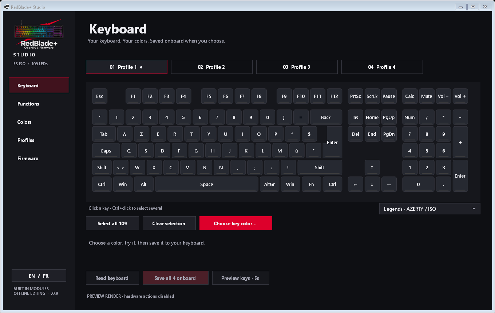
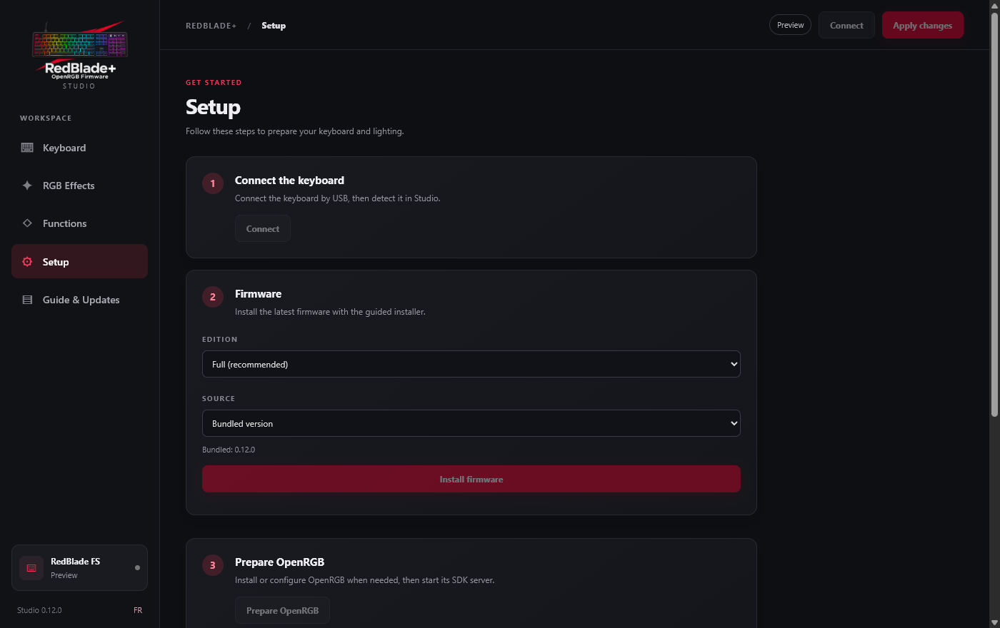
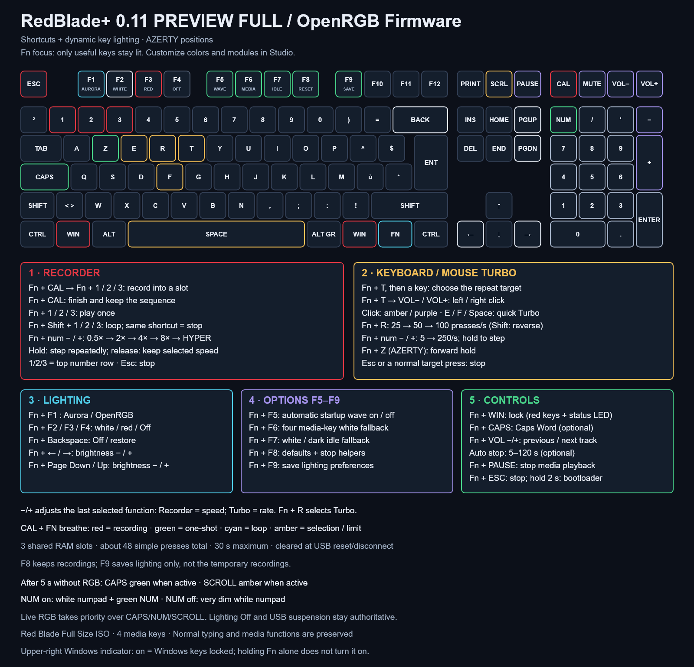

# RedBlade+ · OpenRGB firmware and Studio

**English** · [Français](README.fr.md)

Per-key lighting, onboard profiles and practical shortcuts for the **Designed by GG Red Blade Full Size ISO**. RedBlade+ Studio brings the keyboard, lighting and setup together in a portable Windows x64 application.

[Download Studio 0.12.1 for Windows (EXE)](https://github.com/Gaerisson/redblade-aurora-openrgb/releases/tag/v0.12.1) · [Installation](docs/INSTALL.md) · [Shortcuts](docs/SHORTCUTS.md) · [Studio guide](app/README.md) · [Changelog](CHANGELOG.md)

## Your keyboard, your colors

- **Color Lab:** select keys by click, drag, marquee or gaming-position group. Apply solid colors or linear and radial gradients, and undo or redo changes. Edit the active Full profile and save it to the keyboard.
- **Lighting on the PC:** choose from 12 OpenRGB effects and reactive overlays lasting up to 8 seconds. Studio restores your RGB applications after its effect stops.
- **Lighting on the keyboard:** Full 0.12 provides five autonomous reactive styles lasting up to approximately 4 seconds, with optional Ctrl, Shift and Alt highlights. Four onboard profiles keep your settings available without a running PC effect.
- **Shortcuts at a glance:** the interactive Fn explorer shows a virtual preview of Fn and Shift combinations; it does not monitor the physical Fn key. Full also includes Windows lock, Turbo, Recorder and media controls.

Studio is available in English and French with AZERTY and QWERTY legends. Its virtual preview and software effects are separate from the onboard settings; the new autonomous options require Full 0.12.

## Choose your firmware

| | OpenRGB Core | RedBlade+ Full |
| --- | --- | --- |
| Best for | Per-key OpenRGB/Aurora and VIA | Core features plus onboard lighting and shortcuts |
| Lighting without a host | LEDs turn off after five seconds without RGB | Local profiles, reactive lighting and status indicators |
| Game helpers and Recorder | Not included | Included |
| Firmware file | `redblade-fs-openrgb-core.bin` | `redblade-fs-aurora-via.bin` |

Both editions support VIA remapping and macros, and **Fn + Esc held for two seconds** enters the bootloader. Full provides the Studio onboard-profile configuration; Core does not. See [edition details](docs/EDITIONS.md).

## Guided setup

1. Use a **Red Blade Full Size ISO** with numpad: USB `320F:5136`, Sonix SN32F248B and 109 LEDs. The Red Blade 75 is not supported.
2. Download `RedBladePlus-Studio.exe` from the release and read the [installation and backup guide](docs/INSTALL.md). Studio guides the Full/Core installation, backs up VIA data privately and asks for the physical bootloader step. Review its messages before continuing; keep your backups.
3. Use Studio setup to download and verify the portable OpenRGB 1.1 package, start its SDK and test detection of the 109-LED keyboard. A six-second lighting test checks the effect path. OpenRGB is downloaded from its official source, not bundled. Studio’s optional Windows startup setting does not start RGB or request elevation.
4. For Aurora, select its OpenRGB/RGB.NET provider and use the SDK port shown by Studio. If an existing server on 6742 does not have the RedBlade, Studio can use 6743 alongside it; Aurora's configuration is not changed automatically. OpenRGB can also be used without Aurora.

Close VIA when using RGB applications: they share the keyboard's Raw HID interface. RedBlade+ implements the VialRGB subset needed by OpenRGB, rather than the complete Vial configuration interface. The [installation guide](docs/INSTALL.md) also covers manual flashing and recovery.

## Shortcuts and lighting

[Open the full shortcut guide](docs/SHORTCUTS.md) · [French map](docs/assets/shortcuts.fr.png)

**Fn + F1** returns lighting control to OpenRGB/Aurora; **Fn + F4** selects Off. While Fn is held, the shortcut guide remains visible in this Off mode. This behavior does not claim to override USB suspend or a global VialRGB Off command. **Esc** stops game helpers; the [guide](docs/SHORTCUTS.md) covers their operation and limits.

## Updates and validation

Studio 0.12.1 is a software-only update: Full and Core firmware remain 0.12.0, their BINs are unchanged, and no reflash is needed. Setup offers optional start with Windows for the current user. The first hardware operation may request UAC once; subsequent operations reuse access during the Studio session. The native prerequisites window checks WebView2, Visual C++ x64 and bundled resources; first-time Microsoft runtime installation requires internet.

Studio can check official GitHub releases and offer a verified software update. The update notice is shown when Studio is visible and idle, without interrupting editing or hardware work. The startup dialog's **Later** choice defers automatic installation until the next launch. Firmware is never flashed automatically: installation uses the guided flow and requires physical bootloader entry.

**0.12.0 firmware status:** Studio and Full/Core compile and pass host tests, including real WebView2 checks. Full 0.12 programming, checksum, identity and complete VIA/macros/profile restoration passed on the preparation keyboard. The owner confirmed typing, numpad, Fn lighting after Fn+F4, darkness on Fn release, and Aurora after Fn+F1. SDK detection and the six-second lighting job also passed with the existing OpenRGB server. First-time managed OpenRGB installation on a clean PC and Core physical acceptance remain unverified. Power-cycle persistence, sustained load and physical input latency have not been measured. Studio 0.12.1 hardware acceptance is still pending. See the [audit](docs/AUDIT.md) and 0.12.0 validation records for scope.

The [brightness audit](docs/RGB_BRIGHTNESS.md) found no hidden software gain: color channels reach 255 and driver multipliers default to 1. Electrical or multiplexing changes have not been measured or implemented, so no additional brightness gain is claimed. The project retains requested 1 ms USB polling; [performance tools](docs/PERFORMANCE.md) report host measurements, not physical key latency.

## Documentation and source

[Installation](docs/INSTALL.md) · [Shortcuts](docs/SHORTCUTS.md) · [Editions](docs/EDITIONS.md) · [Studio](app/README.md) · [Performance](docs/PERFORMANCE.md) · [Audit](docs/AUDIT.md) · [Contributing](CONTRIBUTING.md)

The release provides ten assets: Studio EXE and ZIP, two firmware BINs, two manifests, SHA256SUMS and three source archives. Benchmarks and images remain in the repository and source packages. Based on pinned [SonixQMK](https://github.com/SonixQMK/qmk_firmware/tree/62973ee48a976c6f7cc6d4f7b198bd48a2fdfe60), with [OpenRGB](https://github.com/CalcProgrammer1/OpenRGB) and [Aurora](https://github.com/Aurora-RGB/Aurora). Added code is GPL-2.0-or-later; upstream notices and corresponding sources are retained. [License](LICENSE).
