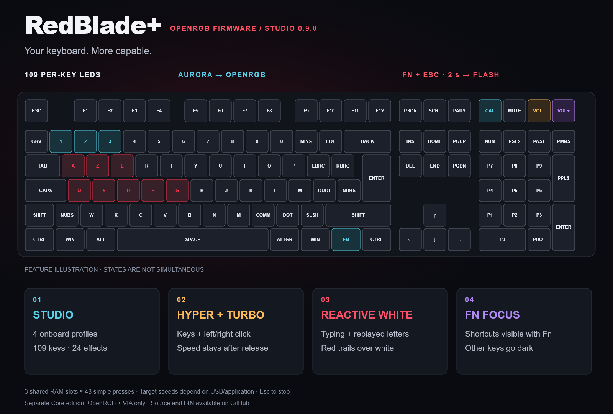

# RedBlade+ · OpenRGB Firmware

**English** · [Français](README.fr.md)

<p align="center"></p>

<p align="center">
  <a href="https://github.com/Gaerisson/redblade-aurora-openrgb/releases/latest"></a>
  <a href="https://github.com/Gaerisson/redblade-aurora-openrgb/actions/workflows/test.yml"></a>
  <a href="LICENSE"></a>
</p>

Per-key OpenRGB lighting, useful Fn shortcuts and game helpers for the **Designed by GG Red Blade Full Size ISO**.

[Download](https://github.com/Gaerisson/redblade-aurora-openrgb/releases/latest) · [Shortcuts](docs/SHORTCUTS.md) · [Install](docs/INSTALL.md) · [Performance](docs/PERFORMANCE.md) · [Changelog](CHANGELOG.md)



## Studio 0.9.0 — preview

RedBlade+ Studio is a portable Windows x64 application for Full 0.9.0. Edit four onboard profiles with 109 per-key colors, 24 effect colors and ten built-in module switches; English/French and AZERTY/QWERTY legends are available. Fn focus darkens unrelated keys while Fn is held. Recorder slots remain temporary; the existing Turbo and Recorder functions are retained. Studio offers guided flashing of bundled Full and Core images. Core does not expose the Full configuration API. See [Studio](app/README.md) and the [configuration protocol](docs/CONFIG_PROTOCOL.md).

**0.9.0 is a preview, with physical validation pending.** [Download Studio and both firmware editions](https://github.com/Gaerisson/redblade-aurora-openrgb/releases/tag/v0.9.0). The last keyboard-validated Full version is 0.8.1. Back up VIA and custom settings before flashing; a full-image flash can erase onboard profiles.


## Choose your edition

| Edition | Included | Firmware |
| --- | --- | --- |
| **OpenRGB Core** | Per-key OpenRGB/Aurora + VIA; no game helpers, Recorder, local effects or added status overlays | `redblade-fs-openrgb-core.bin` |
| **RedBlade+ Full** | Every feature shown below | `redblade-fs-aurora-via.bin` |

Each edition has its own manifest and separate complete-source package. Core turns lights off after 5 s without RGB and retains the guarded Fn + Esc bootloader shortcut. [Choose/switch editions](docs/EDITIONS.md).

## What you get

| Feature | How it works |
| --- | --- |
| Native OpenRGB integration | 109 independently controlled LEDs through VialRGB; Aurora connects through the OpenRGB SDK |
| A useful Fn media deck | Calculator → timed Recorder control, Mute → play/pause, Volume −/+ → previous/next; Shift adds more controls |
| Windows-key lock | Fn + either Windows key; both Windows logos turn red and the dedicated upper-right Windows indicator turns on while locked |
| Choose a Turbo key | Fn + T, then a basic key; live 5–250/s adjustment with Fn + numpad −/+; E/F/Space presets retained |
| Mouse Turbo | Fn + T, then Volume −/+: left/right click, amber/purple indicators, shared cadence |
| Reactive white | Without host RGB, physical typing and replayed letters leave red trails on white |
| Fn RGB status | Breathing Recorder colors; blue idle, cyan Fn held, red Turbo, green hold, purple Game Mode |
| Forward hold | Fn + W on QWERTY / Fn + Z on AZERTY; green active LED |
| Immediate stop | Esc stops game helpers; Fn + Esc also unlocks Windows |
| Local lighting profiles | Host, white, red and Off; brightness works with host colors too |
| Dynamic fallback | Without live RGB: green Caps/Num Lock, amber Scroll Lock, white active numpad / very dim inactive numpad |
| Three temporary recordings | Fn + Calculator, then Fn + 1/2/3 records; Fn + a slot plays once; Shift loops it; live speed 0.5×–8× + Hyper |
| White fallback | Optional white after 5 seconds without RGB, plus fallback for all four media keys |
| Red startup wave | Visible curved 2-second wave and smooth handover to the latest host colors |
| Preferences you control | Fn + F9 saves lighting settings; regular controls and RGB streaming stay RAM-only |
| VIA support | Remapping/macros, with a backed-up Fn-layer upgrade tool |

Game helpers start disabled, stop on USB suspension/disconnection and never resume automatically. They act on the active application; the firmware cannot detect game focus. One Turbo target can run alongside forward hold. Normal presses of a helper's target key give control back to your finger.

## Start with these shortcuts

| Shortcut | Action |
| --- | --- |
| **Fn + Windows** | Toggle Game Mode; both Windows keys turn red |
| **Fn + Calculator → Fn + 1** | Record slot 1; Calculator again finishes |
| **Fn + 1 / Shift + Fn + 1** | Play slot 1 once / loop it |
| **Fn + numpad −/+** | Adjust; hold to step repeatedly; release keeps the value |
| **Fn + E** | Start/stop Turbo E |
| **Esc** | Stop Turbo and forward hold |
| **Fn + F1** | Give lighting control back to OpenRGB / Aurora |
| **Fn + F8** | Restore defaults, stop helpers and unlock Windows |

The [full shortcut guide](docs/SHORTCUTS.md) covers the four-key deck, live cadence, generic key selection, Fn indicators, saving, recovery and bootloader entry. **Fn + Esc held for 2 seconds** enters the bootloader on 0.6.0+. A short press stops helpers/unlocks Windows. Versions 0.4/0.5 used Fn + Shift + Esc.


[Full-size map](docs/assets/shortcuts.svg) · [French map](docs/assets/shortcuts.fr.png)

## Getting started

| Supported hardware | Value |
| --- | --- |
| Keyboard | Red Blade **Full Size ISO**, with numpad — not the Red Blade 75 |
| USB / MCU | `320F:5136` · Sonix SN32F248B |
| Lighting | 109 LEDs, including Calculator, Mute, Volume − and Volume + |

1. Download the release ZIP and read the [backup and flash guide](docs/INSTALL.md#backup-and-flashing).
2. Back up your VIA layout privately, identify the correct bootloader and flash the included `.bin` with SonixFlasherC.
3. If an older VIA Fn layer survived, use the [Fn-layer installer](docs/SHORTCUTS.md#upgrading-an-existing-via-layer) while RGB clients are stopped.
4. Configure OpenRGB/Aurora, then choose **Fn + F1**:

```powershell
pwsh -File tools/configure-windows.ps1 -Apply
pwsh -File tools/configure-aurora-mapping.ps1 -Apply
```

```text
Aurora / another SDK client → OpenRGB → VialRGB → RedBlade+
```

OpenRGB also works without Aurora. VIA and OpenRGB share Raw HID; close VIA during normal RGB use. The firmware provides the VialRGB subset needed by OpenRGB, not the complete Vial configuration UI.

## Performance and validation

- Requested USB polling: **1 ms**; factory eager debounce, NKRO and the shared Sonix scan/PWM timer are preserved.
- RGB work is split into eight-LED chunks with a 33 ms minimum frame interval. Status overlays are bounded; Fn has a persistent idle/active color. Turbo schedules at most one edge per housekeeping pass; no catch-up queue or busy wait.
- A Windows native benchmark and read-only USB timing tool are included. [Run them tonight](docs/PERFORMANCE.md); host timings are not physical key-latency measurements.

**0.8.1 is experimental.** The 0.8 feature set was confirmed on the keyboard: reactive white/replay, latched Hyper, click Turbo and Aurora priority. On 0.8.1, the owner confirmed the dedicated Windows indicator, Fn-only Off, retained lock status after Fn release, operation with RGB Off, unlock, typing and Aurora. Core is build/host-tested, with no hardware validation claimed. See the [audit](docs/AUDIT.md), [manifest](dist/manifest.json) and [test workflow](.github/workflows/test.yml) for the exact scope.

The keyboard turns its RGB off when USB is suspended or unconfigured. A host that keeps the USB bus genuinely active after shutdown cannot be distinguished from an application that stopped sending colors; see the [USB power limitations](docs/INSTALL.md#fallback-lighting-and-red-wave--070).

## Project files

- [Installation and technical reference](docs/INSTALL.md) · [French reference](docs/INSTALL.fr.md)
- [All shortcuts](docs/SHORTCUTS.md) · [Performance tools](docs/PERFORMANCE.md) · [Code audit](docs/AUDIT.md)
- [Changelog](CHANGELOG.md) · [Contributing](CONTRIBUTING.md) · [Logo and generation prompt](assets/LOGO.md)

Based on pinned [SonixQMK](https://github.com/SonixQMK/qmk_firmware/tree/62973ee48a976c6f7cc6d4f7b198bd48a2fdfe60), with native [OpenRGB](https://github.com/CalcProgrammer1/OpenRGB) / [Aurora](https://github.com/Aurora-RGB/Aurora) integration. Added code is GPL-2.0-or-later; upstream notices and corresponding sources are retained. [License](LICENSE).
