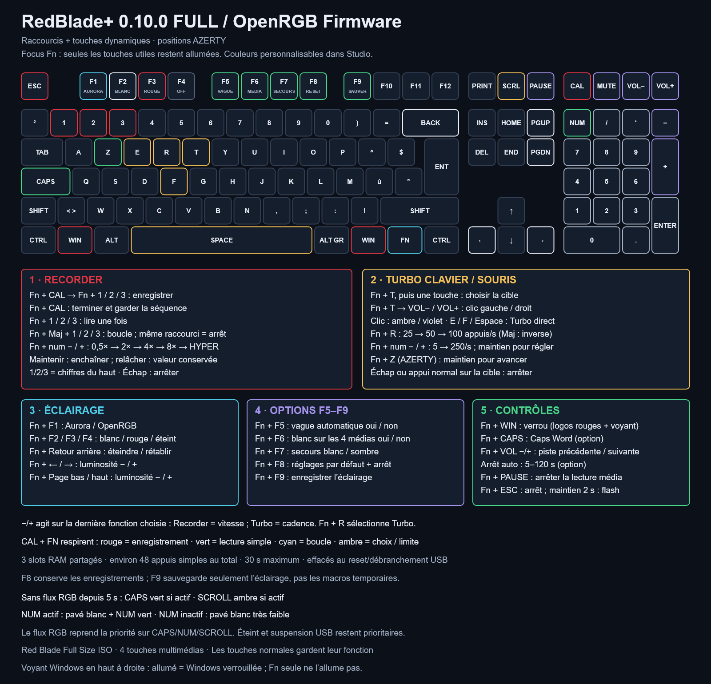

# Raccourcis RedBlade+

[English](SHORTCUTS.md) · **Français** · [Projet](../README.fr.md) · [Installation](INSTALL.fr.md)

**Full 0.10 en aperçu :** Fn + Verr. Maj active ou désactive Caps Word (AZERTY ou QWERTY), désactivé par défaut. Le délai de sécurité optionnel arrête les fonctions automatiques et la lecture Recorder après 5 à 120 secondes (30 par défaut), sans interrompre la capture ni effacer les séquences. Il est désactivé par défaut.

Firmware **0.8.1**, Red Blade Full Size ISO. Fn est entre Windows droite et Ctrl droit. **1/2/3 désigne la rangée de chiffres au-dessus des lettres** ; **−/+ désigne le pavé numérique**.

## 1. Recorder — trois emplacements temporaires

Exemple : enregistrer une courte séquence dans le slot 1 puis la rejouer.

1. Relâche les autres touches. Appuie sur **Fn + Calculatrice**, puis relâche : Calculatrice et Fn respirent en **ambre** pour demander un emplacement.
2. Appuie sur **Fn + 1**, puis relâche. Calculatrice, Fn et 1 respirent en **rouge** : tape normalement ta séquence. La première touche sera rejouée immédiatement ; les délais entre les frappes suivantes sont conservés à la milliseconde.
3. Appuie à nouveau sur **Fn + Calculatrice** pour terminer. Choisir un emplacement déjà rempli pour enregistrer remplace son contenu ; les deux autres restent conservés.
4. **Fn + 1** rejoue une fois, avec une respiration **verte**. **Fn + Maj + 1** lance la boucle : relâche Fn et Maj pour démarrer ; la respiration devient **cyan**. Le même raccourci de boucle l’arrête.
5. **Échap**, **Fn + Calculatrice**, un appui court **Fn + Échap**, ou une frappe normale arrête la lecture. Ta frappe normale est ensuite traitée normalement. Échap termine aussi un enregistrement ; il n’est pas ajouté à la séquence.

| Commande Recorder | Action |
| --- | --- |
| Fn + Calculatrice | Préparer le choix ; terminer l’enregistrement ; arrêter la lecture ; annuler le choix |
| Fn + 1 / 2 / 3 pendant le choix | Enregistrer dans cet emplacement |
| Fn + 1 / 2 / 3 sinon | Lire cet emplacement une fois |
| Fn + Maj + 1 / 2 / 3 | Lire en boucle ; même raccourci pour arrêter |
| Fn + − / + du pavé | Descendre / monter : **0,5×, 0,75×, 1×, 1,25×, 1,5×, 1,75×, 2×, 4×, 8×, Hyper** |

**Un appui change d’un cran ; un maintien enchaîne les crans** (400 ms au départ, puis 150 ms par cran). La valeur **reste sélectionnée au relâchement**. Un ou plusieurs − permettent de revenir aux vitesses classiques. Hyper vise **une transition enregistrée par milliseconde**, avec au moins 5 ms entre deux boucles ; il abandonne le rythme d’origine. Défaut : 1×. Pendant une lecture/Turbo actif, −/+ du pavé seuls règlent aussi la vitesse ; au repos ou en enregistrement, ils sont saisis normalement.

−/+ agit sur la **dernière fonction choisie** : Recorder règle la vitesse de lecture ; Turbo règle les appuis/s. Calculatrice ou un slot sélectionne Recorder. Fn + R ou un raccourci Turbo sélectionne Turbo et arrête Recorder. Avec Fn maintenue, les indices −/+ violets signalent le contexte Recorder. Régler la vitesse ne modifie jamais les délais enregistrés.

Les trois emplacements partagent **192 octets de RAM**, soit **environ 48 appuis simples au total**, moins avec les modificateurs ou les longues pauses. Un enregistrement dure au plus **30 secondes**. Si la mémoire est pleine ou la durée atteinte, la partie capturée est terminée proprement, conservée et signalée brièvement en ambre. Un slot vide ou des touches/modificateurs encore maintenus donnent aussi un signal ambre : relâche les touches puis réessaie. Le choix du slot expire après 10 secondes. Avec Fn maintenue, un slot rempli est vert ; un slot vide est très faible.

Le Recorder conserve les appuis/relâchements du clavier standard et les touches physiques Ctrl/Alt/Maj/Windows, y compris les maintiens et chevauchements. Il ne capture pas la souris, les commandes multimédias, les commandes Fn ni les macros/actions QMK avancées. La disposition Windows, Verr. Maj/Num et l’application déterminent le résultat : ce sont des événements clavier, pas du texte mémorisé. Le firmware ne reconnaît pas la fenêtre active.

La lecture ne possède que ses touches générées et les libère à l’arrêt. Une boucle conserve au moins 5 ms de relâchement entre deux passages, sans rattrapage en rafale. Le mode jeu refuse un enregistrement contenant Windows. Recorder et Turbo/maintien sont exclusifs : démarrer l’un arrête l’autre. Rien ne démarre automatiquement.

**Temporaire = RAM uniquement** : aucune écriture EEPROM, aucun contenu exporté par le diagnostic, aucune sauvegarde avec F9. Reset/déconfiguration USB, débranchement ou coupure d’alimentation effacent les slots. Une simple veille USB alimentée arrête les fonctions et peut conserver les slots terminés ; un reset USB à la reprise les efface. Aucune lecture ne reprend seule. F8 arrête les fonctions et remet la vitesse à 1×, en conservant les slots RAM présents.

## 2. Turbo et jeu

| Raccourci | Action |
| --- | --- |
| Fn + T, puis appuyer/relâcher une touche | Choisir la cible ; choix ambre, puis Fn/cible rouges |
| Fn + T, puis Volume − / + | Turbo clic gauche / droit au relâchement ; touche volume et Fn ambre / violet |
| Fn + E / F / Espace | Démarrer/arrêter un Turbo direct |
| Fn + R / Fn + Maj + R | Préréglage suivant / précédent : **25, 50, 100 appuis/s** ; sélectionner Turbo |
| Fn + − / + du pavé, contexte Turbo | **5–100/s par pas de 5, puis 125/150/175/200/225/250/s** ; maintien pour enchaîner, valeur conservée au relâchement |
| Fn + Z en AZERTY / Fn + W en QWERTY | Maintenir pour avancer ; cible verte |
| Fn + une touche Windows | Verrouiller/déverrouiller Windows ; **les deux touches sont rouges et le voyant Windows en haut à droite s’allume** |
| Fn + Maj + une touche Windows | Déverrouiller Windows |
| Échap | Arrêter les fonctions ; Échap est aussi envoyé à l’application |
| Fn + Échap, appui court | Arrêter et déverrouiller Windows ; aucun Échap envoyé |

Le Turbo souris partage la cadence et remplace le Turbo clavier. Il envoie uniquement des boutons HID, sans bouger le pointeur. **Échap**, Fn + T, Calculatrice/un slot, F8, suspension USB ou un appui sur la touche volume cible arrête et libère le clic. Les volumes et commandes médias restent normaux hors sélection/Turbo clic actif. Le Recorder n’enregistre pas la souris.

Turbo démarre à 50/s. Un Turbo peut fonctionner avec le maintien pour avancer. Un appui normal sur une cible rend la main à ton doigt. La cadence est une cible, dépendante de l’USB et de l’application ; une seule transition est produite par passage, sans attente active ni rafale de rattrapage.

Le choix Turbo utilise la touche standard de la couche de base VIA, même si Fn reste maintenue. Fn, modificateurs, Échap, alimentation/système, médias et macros ne sont pas des cibles. Le choix expire après 10 secondes ; Fn + T pendant un Turbo l’arrête. Le mode jeu filtre Windows et les raccourcis QMK simples utilisant Windows, pas toutes les macros ou actions avancées.

## 3. Éclairage — F1 à F4

| Raccourci | Action |
| --- | --- |
| Fn + F1 | Rendre les couleurs à Aurora / OpenRGB |
| Fn + F2 | Blanc réactif local avec traînées rouges |
| Fn + F3 | Profil rouge local |
| Fn + F4 | Éteindre |
| Fn + Retour arrière | Éteindre / rétablir le profil précédent |
| Fn + Gauche / Droite | Luminosité − / + |
| Fn + Page bas / Page haut | Luminosité − / + |

Les profils locaux gardent leurs couleurs pendant la réception du flux. F1 reprend des couleurs fraîches. La vague rouge est automatique si activée. Fn + Entrée et Fn + Haut/Bas sont désormais transmis comme les touches normales.

## 4. Réglages — F5 à F9

| Raccourci | Rôle | Défaut / sauvegarde |
| --- | --- | --- |
| **Fn + F5** | Vague rouge automatique au démarrage/reprise | Activée ; F9 enregistre ce choix |
| **Fn + F6** | Blanc des quatre touches multimédias si le PC les laisse noires | Activé ; F9 enregistre ce choix |
| **Fn + F7** | Sans RGB depuis 5 secondes : blanc de secours / sombre | Blanc ; F9 enregistre ce choix |
| **Fn + F8** | Éclairage par défaut, arrêt, Windows déverrouillé, Turbo 50/s et Recorder 1× | RAM ; conserve VIA et les slots enregistrés |
| **Fn + F9** | Enregistrer profil, luminosité et options F5/F6/F7 | Écriture explicite ; ne sauvegarde pas les slots Recorder ni les fonctions de jeu |

Avec Fn maintenue, F5/F6/F7 sont verts quand activés. F8 restaure aussi la luminosité QMK pour récupérer un réglage externe à zéro. F9 donne un bref vert sur Calculatrice si aucun indicateur Recorder prioritaire n’est actif. Les commandes ordinaires et le flux RGB n’écrivent pas en EEPROM. Éteint/luminosité zéro masque aussi les voyants, mais Échap reste utilisable.

## 5. Les quatre touches multimédias

| Touche | Seule | Avec Fn | Avec Fn + Maj |
| --- | --- | --- | --- |
| Calculatrice | Calculatrice | Commande Recorder | Même commande Recorder |
| Muet | Couper/remettre le son | Lecture/pause | Arrêter la lecture |
| Volume − | Baisser le volume | Piste précédente | Baisser la luminosité |
| Volume + | Monter le volume | Piste suivante | Monter la luminosité |

Fn + Pause arrête aussi la lecture multimédia. Relâcher Fn/Maj avant la touche ne laisse pas de touche générée maintenue.

## Touches dynamiques et couleurs

Full 0.9 ajoute le **focus Fn** : maintenir Fn éteint les touches sans raccourci Fn fourni. Les raccourcis des modules désactivés dans Studio sont aussi masqués. Relâcher Fn rétablit les couleurs du logiciel ou du profil local. Studio permet de désactiver ce focus et d’modifier le profil actif avec 109 couleurs par touche et 24 couleurs d’effets. Les couleurs ci-dessous sont celles d’usine. Un raccourci Fn déplacé dans VIA ne déplace pas automatiquement son indicateur lumineux.

Le **profil hôte par défaut donne priorité à Aurora/OpenRGB**. Après **5 secondes sans RGB**, il passe au **blanc avec traînées rouges** : chaque frappe physique, Turbo ou lettre rejouée s’allume, puis revient au blanc en environ une demi-seconde (15 images, durée dépendante de la charge). Fn + F2 choisit ce blanc réactif explicitement. Les indicateurs de verrouillage restent prioritaires.

Une frappe physique éclaire sa position réelle. Le rejeu utilise les positions des touches d’origine : après remappage VIA, la lumière suit la touche d’origine correspondant au code rejoué. Le texte dépend toujours de la disposition du PC. Aucun effet de frappe ne recouvre un flux RGB actif dans le profil hôte.

Le blanc de secours et le profil blanc local reflètent aussi les états :

| État | Éclairage |
| --- | --- |
| Verr. Maj actif / inactif | Verr. Maj verte / blanche ; les touches Maj restent inchangées |
| Verr. Num actif | Les 17 touches du pavé blanches ; Num verte |
| Verr. Num inactif | Tout le pavé blanc très faible, valeur linéaire 8/255 |
| Verr. défilement actif | Défilement ambre |

Un nouveau flux reprend la priorité sur ces états. Rouge/effets autonomes, secours sombre, éteint, luminosité zéro et suspension USB restent prioritaires. Le secours des quatre médias est séparé : couleur non noire du PC prioritaire, F6 active/désactive le blanc s’ils sont noirs. Le protocole ne distingue pas un noir volontaire d’une affectation absente.

Calculatrice/Fn/slot actif respirent en rouge pendant l’enregistrement, vert pour une lecture, cyan en boucle, ambre pendant choix/attente/limite. Sinon Fn est bleue discrète au repos, cyan enfoncée, rouge pendant Turbo clavier, ambre pour clic gauche, violette pour clic droit, verte pendant maintien, violette en mode jeu. Les fonctions actives sont prioritaires. Le voyant Windows monochrome en haut à droite indique le verrouillage, indépendamment de Fn et du RGB. Il reste allumé si Windows est bloquée même RGB éteint ; déverrouillage, remise à zéro et suspension USB l’éteignent.

## Bootloader

**Maintenir Fn + Échap 2 secondes**. Relâcher l’une des touches annule ; un appui court arrête et déverrouille. Maj reste facultative. Les versions 0.4/0.5 utilisaient Fn + Maj + Échap ; la 0.1 pouvait basculer immédiatement.

## Mise à jour du calque VIA

Fermer OpenRGB, Aurora et VIA puis utiliser l’[installateur avec sauvegarde privée](SHORTCUTS.md#upgrading-an-existing-via-layer). Il demande la 0.7.0, installe **33 commandes**, efface explicitement les **3 anciens raccourcis** Haut/Bas/Entrée et vérifie les écritures avec tentative de retour arrière en cas d’erreur. Les touches de base, les macros VIA et les autres affectations Fn sont conservées. Les slots Recorder sont distincts des macros VIA et ne figurent pas dans la sauvegarde.
