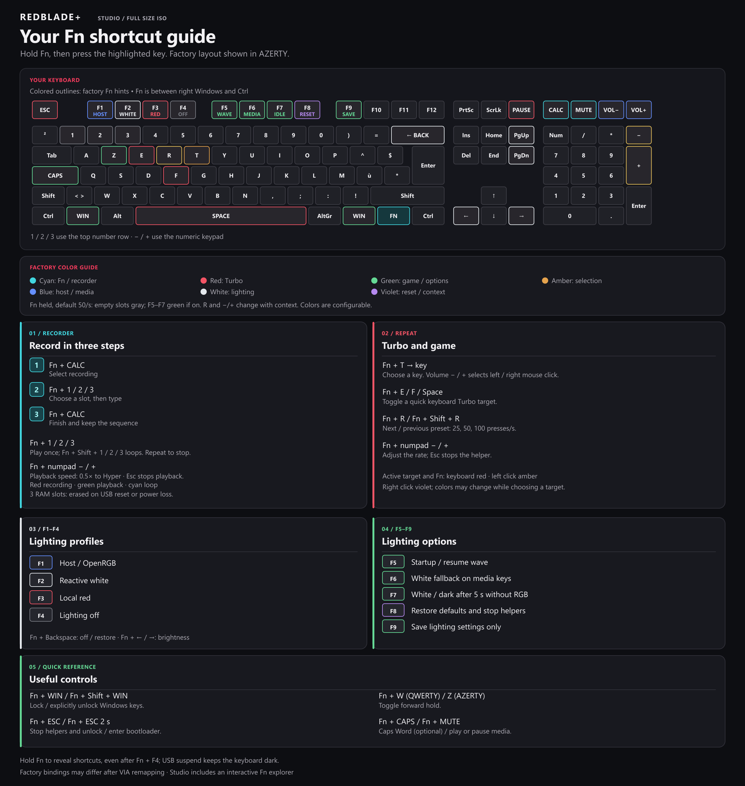

# RedBlade+ shortcuts

**English** · [Français](SHORTCUTS.fr.md) · [Project](../README.md) · [Installation](INSTALL.md)

**Full 0.10 preview:** Fn + Caps toggles optional Caps Word (AZERTY or QWERTY); it is off by default. Optional automatic safety stops generated helpers and Recorder playback after 5–120 seconds (default 30), without stopping recording capture or erasing slots. This feature is off by default.


Default firmware **0.8.1**, Red Blade Full Size ISO. Fn is between Right Windows and Right Ctrl. Numbers 1/2/3 below mean the **top number row**; −/+ mean the **numpad**.



## 1. Recorder — three temporary slots

Example: save a short sequence in slot 1, then replay it.

1. Release other keys. Press **Fn + Calculator**, then release: Calculator/Fn breathe amber while waiting for a slot.
2. Press **Fn + 1**, then release. Calculator, Fn and 1 breathe **red**: type your sequence normally. Its first key starts immediately on playback; delays between later key edges are stored in milliseconds.
3. Press **Fn + Calculator** again to finish. The sequence is ready. Choosing an existing slot for recording replaces its previous contents; the other two slots are retained.
4. Press **Fn + 1** to play once: the indicators breathe **green**. **Fn + Shift + 1** loops it: release Fn/Shift to start; indicators breathe **cyan**. The same loop shortcut toggles it off.
5. **Esc**, **Fn + Calculator**, a short **Fn + Esc**, or an ordinary physical key press stops playback. A real key press is then handled normally. Esc also finishes an active recording; it is not recorded as part of the sequence.

| Recorder control | Action |
| --- | --- |
| Fn + Calculator | Arm slot selection; finish recording; stop playback; cancel selection |
| Fn + 1 / 2 / 3 while armed | Record into that slot |
| Fn + 1 / 2 / 3 otherwise | Play that slot once |
| Fn + Shift + 1 / 2 / 3 | Loop that slot; same loop shortcut stops it |
| Fn + numpad − / + | Step down / up: **0.5×, 0.75×, 1×, 1.25×, 1.5×, 1.75×, 2×, 4×, 8×, Hyper** |

**Tap for one step; hold for repeated steps** (400 ms initial hold, then one step per 150 ms). The selected value **stays after release**. Use − once or several times to return to classic speeds. Hyper targets **one recorded edge per millisecond**, with the minimum 5 ms loop gap retained; it does not preserve the original phrase rhythm. Default speed is 1×. During active phrase/Turbo playback, bare numpad −/+ also controls speed; outside playback, including during recording, bare numpad −/+ types normally.

The −/+ controls affect the **last selected function**: Recorder adjusts playback speed; Turbo adjusts presses/s. Choosing a slot or Calculator selects Recorder. Fn + R or a Turbo shortcut selects Turbo and stops Recorder. Purple −/+ hints with Fn held indicate Recorder context. Speed changes affect playback, never the timing being recorded.

The three slots share **192 RAM bytes**, approximately **48 simple key presses in total**, fewer with modifiers or long pauses. A recording lasts at most **30 seconds**. Full memory or the time limit ends it cleanly, saves the captured part and gives brief amber feedback. An empty slot or held keys/modifiers also gives amber feedback; release other keys and try again. Slot selection expires after 10 seconds. With Fn held, a nonempty slot is green and an empty slot is dim.

Recordings capture basic keyboard press/release events and physical Ctrl/Alt/Shift/Windows, including holds and overlaps. They do not capture mouse input, media actions, Fn commands or advanced QMK/VIA macros/mod-tap actions. The current host layout, Caps/Num state and application still determine the result: these are keyboard events, not stored text. The firmware cannot detect application focus.

Playback owns only its generated keys and releases them on stop. A loop has a minimum 5 ms release gap between iterations and no catch-up bursts. Game Mode refuses recordings containing Windows-key events. Recorder and Turbo/forward hold are mutually exclusive; selecting one stops the other. Helpers always start inactive.

**Temporary means RAM-only:** no recorder EEPROM writes, no payload export through diagnostics, no saving through F9. USB reset/deconfiguration, disconnection or power loss clears the slots. A simple powered USB suspension stops playback/recording and can retain completed slots, but an actual USB reset on resume clears them; nothing resumes automatically. F8 stops helpers and resets speed to 1× but retains the current RAM slots.

## 2. Turbo and game controls

| Shortcut | Action |
| --- | --- |
| Fn + T, then press/release a key | Choose a basic key to repeat; amber selection, then red Fn/target |
| Fn + T, then Volume − / + | Start left / right click Turbo on release; amber / purple volume-key indicator and matching Fn |
| Fn + E / F / Space | Toggle a quick Turbo target |
| Fn + R / Fn + Shift + R | Next / previous preset: **25, 50, 100 presses/s**; selects Turbo context |
| Fn + numpad − / + in Turbo context | **5–100/s in steps of 5, then 125/150/175/200/225/250/s**; hold to step repeatedly, release keeps the value |
| Fn + W on QWERTY / Fn + Z on AZERTY | Toggle forward hold; green target |
| Fn + either Windows key | Toggle Game Mode; **both Windows keys turn red and the upper-right Windows indicator lights** |
| Fn + Shift + either Windows key | Explicitly unlock Windows |
| Esc | Stop helpers; Escape is still sent to the application |
| Fn + Esc, short press | Stop helpers and unlock Windows; no Escape is sent |

Mouse Turbo shares the same target rate and replaces keyboard Turbo. It emits button-only HID reports, with no cursor movement. **Esc**, Fn + T, Calculator/slot selection, F8, USB suspension or pressing the active volume target stops it and releases the generated button. Outside selection/running click Turbo, volume/media controls work normally. The Recorder does not record mouse clicks.

Default Turbo rate is 50/s. One Turbo target can coexist with forward hold. Ordinary target presses give control back to your finger. Rates are targets, subject to USB scheduling and application behavior. The engine emits at most one edge per cooperative pass, with no busy wait or catch-up queue.

Turbo selection uses the chosen VIA base-layer basic key, even with Fn held. Fn/layers, modifiers, Esc, system/power/media actions and macros are excluded. Selection expires after 10 seconds. Fn + T while running stops Turbo. E/F/R positions are the same on usual AZERTY/QWERTY layouts; W/Z names identify the same physical forward position. Game Mode blocks standalone Windows keys and simple QMK GUI chords, not arbitrary VIA macros or every advanced modifier action.

Full 0.12: hold Fn to reveal the shortcut lighting even after Fn + F4. Release Fn to return to darkness. USB suspension and globally disabled VialRGB output remain dark.

## 3. Lighting — F1 to F4

| Shortcut | Action |
| --- | --- |
| Fn + F1 | Give lighting control to Aurora / OpenRGB |
| Fn + F2 | Local reactive white profile; red key trails |
| Fn + F3 | Local red profile |
| Fn + F4 | Lighting Off |
| Fn + Backspace | Toggle Off / previous profile |
| Fn + Left / Right | Master brightness − / + |
| Fn + Page Down / Page Up | Master brightness − / + |

Local profiles keep their colors while host packets continue arriving. F1 returns to fresh host colors. The red startup wave is automatic when enabled; Fn + Enter and Fn + Up/Down are no longer firmware commands and pass through as normal keys.

## 4. Options — F5 to F9

| Shortcut | What it changes | Default / storage |
| --- | --- | --- |
| **Fn + F5** | Automatic red startup/resume wave | On; F9 saves this option |
| **Fn + F6** | White fallback for Calculator, Mute, Volume −/+ when host leaves them black | On; F9 saves this option |
| **Fn + F7** | After 5 seconds without RGB, choose white fallback / dark | White; F9 saves this option |
| **Fn + F8** | Lighting defaults, stop helpers, unlock Windows, Turbo 50/s, Recorder 1× | RAM only; keeps VIA keys/macros and current recorded slots |
| **Fn + F9** | Save profile, brightness and F5/F6/F7 lighting options | Explicit EEPROM write; does not save recordings, Game Mode or helpers |

F5/F6/F7 show green hints while enabled. F8 restores QMK engine brightness too, for recovery from external brightness zero. F9 briefly flashes Calculator green when no higher-priority recorder indicator is active. Ordinary controls and RGB streaming do not write EEPROM. At Off or zero master brightness the status backlights are dark too; Esc still works.

## 5. The four media keys

| Key | Normal | Fn | Fn + Shift |
| --- | --- | --- | --- |
| Calculator | Open Calculator | Recorder control | Same Recorder control |
| Mute | Mute audio | Play/pause | Stop playback |
| Volume − | Lower volume | Previous track | Dim lighting |
| Volume + | Raise volume | Next track | Brighten lighting |

Fn + Pause also stops media playback. Fn/Shift can be released before the media key without leaving a generated key held.

## Dynamic lights and status

Full 0.9 adds **Fn focus**: hold Fn to darken keys with no shipped Fn shortcut. Shortcuts for modules disabled in Studio are hidden too. Releasing Fn restores the host/local frame. Studio can disable Fn focus, customize the 109-key palette and 24 effect colors, and edit the active onboard profile. The colors below describe factory defaults. Remapped VIA Fn assignments do not automatically change the factory-position light map.

The default **host profile gives Aurora/OpenRGB priority**. After **5 seconds without RGB packets**, it becomes **white with red key trails**: physical typing, Turbo and Recorder replay light the corresponding keys, then fade back over approximately half a second (15 rendered frames, frame rate/load dependent). Fn + F2 selects this reactive white explicitly. Lock indicators retain priority over key trails.

Physical typing follows the actual key position. Recorder replay uses factory base-key positions; if you remap usages with VIA, its replay light follows the original factory key for that usage. Typed characters still follow your host language/layout. No reactive trails are layered over fresh host RGB in the host profile.

White fallback and the explicit White profile also reflect lock state:

| State | Light |
| --- | --- |
| Caps Lock on / off | Caps Lock green / white; Shift keys unchanged |
| Num Lock on | All 17 numpad keys white; Num Lock green |
| Num Lock off | Entire numpad very dim white, linear value 8/255 |
| Scroll Lock on | Scroll Lock amber |

Fresh RGB packets regain priority over Caps/Num/Scroll fallback. Red/native effects, dark idle, Off, zero master brightness and USB suspension remain authoritative. Four-media-key fallback is separate: nonblack host colors win; F6 toggles fallback when they are black. This also replaces intentionally black media colors, since the protocol cannot distinguish them from missing assignments.

Calculator/Fn/active slot breathe red while recording, green for one-shot, cyan for loops, amber during selection/wait/feedback. Otherwise Fn is dim blue idle, cyan held, red during keyboard Turbo, amber for left-click Turbo, purple for right-click Turbo, green during forward hold, purple in Game Mode, with helper priority over ordinary Fn status. These are RGB key backlights; the separate monochrome upper-right Windows indicator shows Game Mode, not Fn held. It stays on with Windows locked even when RGB is Off; unlock/defaults/USB suspension turn it off.

## Bootloader

**Hold Fn + Esc for 2 seconds**. Releasing either key early cancels. A short press stops helpers/unlocks; Shift is optional. Versions 0.4/0.5 required Fn + Shift + Esc; 0.1 may enter immediately with Fn + Esc.

## Upgrading an existing VIA layer

Stop OpenRGB, Aurora and VIA, then run from the project root:

```powershell
python tools/install-fn-layer.py
python tools/install-fn-layer.py --apply --backup C:\private-path\before-redblade-plus.json
```

Applying requires 0.7.0+, makes a complete private VIA backup before any write, installs **33 bindings** and explicitly clears the **3 removed Fn commands** (Up, Down, Enter), verifies writes and attempts rollback after errors. Base keys, VIA macros and other Fn cells are retained. RAM recordings are not VIA macros and are not part of the backup. Keep backups private.
